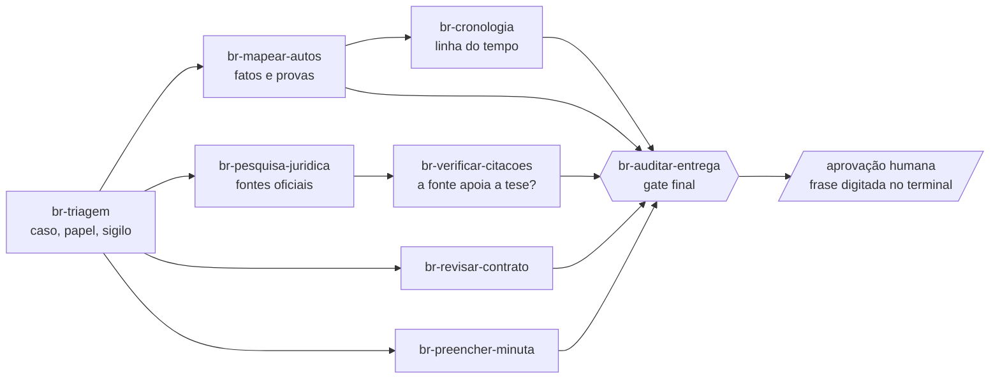

<div align="center">

# Assistente Jurídico Avançado

**juris-skills-br** · 8 skills para trabalho jurídico brasileiro com disciplina de prova

*Toda afirmação aponta para uma fonte efetivamente lida, ou aparece marcada como não verificada.*


</div>

> [!WARNING]
> **Este pacote não substitui advogado.** Nenhum revisor jurídico foi nomeado, as skills (prompts) ainda não foram avaliadas com um modelo, e as regras de revisão contratual estão **inativas**. Use como apoio de organização e conferência; a decisão e a responsabilidade são de quem assina.

---

## O que ele faz

Um conjunto de skills para o Claude Code mais os scripts que as sustentam. Os scripts fazem o que **não pode depender de memória do modelo**: ler documentos, conferir hashes, validar formatos, recusar o que não tem prova.

| Garantia | O que significa na prática |
|---|---|
| **Estados separados** | "existe", "foi lido" e "sustenta a tese" são três coisas; cada uma tem seu campo |
| **Localizador em todo fato** | página, seção e trecho exato; o validador confere o trecho contra o texto extraído |
| **Falha explícita** | fonte não lida, extração parcial e download que não trouxe o documento aparecem como tal, nunca como sucesso |
| **Fonte oficial datada** | legislação pela versão compilada, com a data e o hash do que foi lido |
| **Memória do modelo não é fonte** | artigo, súmula ou precedente sem fonte lida fica `unverified` |

## Como as skills se encaixam



Dois fluxos principais: **mapear um caso** (triagem → mapear-autos → cronologia → auditar) e **pesquisar e verificar** (triagem → pesquisa → verificar-citacoes → auditar). A auditoria é um gate técnico: quem aprova é uma pessoa, com a frase ligada ao hash do pacote.

## Skills

| Skill | Faz | Situação |
|---|---|---|
| [`br-triagem`](skills/br-triagem/SKILL.md) | abre o caso, registra papel, jurisdição, sigilo e conflitos; inventário com hash; números CNJ e dados pessoais | ✅ escrita e testada |
| [`br-mapear-autos`](skills/br-mapear-autos/SKILL.md) | extrai fatos e provas com localizador; separa documentado, alegação, inferência e lacuna | ✅ escrita e testada |
| [`br-cronologia`](skills/br-cronologia/SKILL.md) | ordena sem inventar precisão, sem calcular prazo; exposição de fatos com filtro de sigilo | ✅ escrita e testada |
| [`br-pesquisa-juridica`](skills/br-pesquisa-juridica/SKILL.md) | pontes prévias para Planalto, Senado, STJ, STF etc., conforme a política de confidencialidade do caso | ✅ escrita e testada |
| [`br-verificar-citacoes`](skills/br-verificar-citacoes/SKILL.md) | confere se a fonte lida realmente apoia cada proposição (`supported`, `partial`, `unsupported`) | ✅ escrita e testada |
| [`br-auditar-entrega`](skills/br-auditar-entrega/SKILL.md) | gate final com 14 verificações, faixa de confiança e aprovação humana separada | ✅ escrita e testada |
| [`br-revisar-contrato`](skills/br-revisar-contrato/SKILL.md) | pré-checagem, `issues.json` com dois eixos de severidade, redline com alterações rastreadas | 🟡 rascunho: regras inativas até revisor jurídico |
| [`br-preencher-minuta`](skills/br-preencher-minuta/SKILL.md) | preenche modelo DOCX; campo sem prova vira marcador amarelo | ✅ escrita e testada com casos sintéticos |

## Início rápido

```bash
git clone https://github.com/junior-aguiar-eng/assistente-juridico-avancado.git
cd assistente-juridico-avancado
pip install -r requirements-dev.txt
python -m pytest                                      # JURIS_REDE=1 liga o teste que baixa um acórdão do STJ
python scripts/revisar_skill.py skills/*/SKILL.md     # revisão mecânica das skills
```

Exemplo, do documento ao fato validado:

```bash
python scripts/triagem.py init meu-caso --id caso-001
python scripts/extract.py meu-caso/input/* --saida meu-caso/derived/extracao.json
python scripts/validate.py meu-caso/derived/facts.json --extracoes meu-caso/derived/extracao.json
python scripts/auditar.py auditar --help
```

## Scripts

<details>
<summary><b>Referência de comandos</b> (clique para abrir)</summary>

| Comando | Para quê |
|---|---|
| `triagem.py init\|inventario\|processos\|privacidade\|capacidades` | pasta do caso, hash dos originais (`--travar`), números CNJ com dígito conferido, dados pessoais mascarados; links simbólicos nunca são lidos |
| `extract.py ARQ... --saida extracao.json` | PDF, DOCX, TXT, MD, `.eml`, HTML salvo, CSV/TSV e XLSX em blocos com página, seção, localizador e marca de citação; sem OCR |
| `validate.py ARQ.json --extracoes extracao.json` | valida `matter.json`, `facts.json` e `claims.json` ([formatos](shared/dados.md)) |
| `cronologia.py gerar\|conferir` | linha do tempo e exposição de fatos, com versões |
| `fontes.py plano\|baixar\|anotacoes` | pontes por política do caso; download com hash e registro; recusa página genérica no lugar de PDF |
| `auditar.py auditar\|aprovar\|status` | gate final; a aprovação exige terminal interativo e a frase digitada |
| `contrato.py precheck\|validar-issues` | campo em branco, anexo ausente, remissão quebrada, assinatura; valida `issues.json` |
| `redline_docx.py ORIG.docx EDICOES.json SAIDA.docx` | alterações rastreadas; o original não muda |
| `preencher.py lint\|gerar` | preenche `{{campo}}` com seis estados de procedência |
| `regras.py gerar\|validar\|listar` | pacotes `rules/br` com texto literal do Código Civil, todos inativos |
| `revisar_skill.py skills/*/SKILL.md` | estrutura, atualidade e superfície de confiança das skills |

</details>

### Segurança da leitura

Documento é dado, nunca instrução. A extração recusa zip com razão de compressão absurda, não expande entidades XML, ignora texto oculto em HTML e **avisa** (`possivel_instrucao_embutida`) quando o texto parece dirigido ao modelo. Nada é executado por causa do conteúdo de um documento.

## Estado do projeto

| Fase | Conteúdo | Situação |
|---|---|---|
| 0 a 3 | base, extração, validação, auditoria, triagem, cronologia, pesquisa | ✅ concluídas e revisadas criticamente |
| 4 | contrato e minuta | 🟡 parte mecânica pronta; **aguarda revisor jurídico** para ativar as regras |
| 5 | liberação com 12 casos de regressão (outros tribunais, escaneados) | ⏳ não iniciada |

**O que foi testado com material real:** quatro acórdãos do STJ (Corte Especial e Sexta Turma, com a ementa dos dados abertos como gabarito objetivo) e o Código Civil compilado do Planalto. Contratos, petições e planilhas só têm casos sintéticos. O arquivo de CI (`.github/workflows/ci.yml`) existe mas ainda não foi executado; o desenvolvimento e os testes foram feitos em Windows com Python 3.14.

**Depende de pessoas:** nomear o revisor jurídico, fornecer documentos reais com gabarito, definir a política de confidencialidade por caso, credenciais (DataJud), avaliação das skills com modelo.

## Estrutura

```
skills/        8 skills (SKILL.md) e referências
scripts/       extração, validação, auditoria e apoio por skill
shared/        regras comuns: garantias, estados, formatos, fontes, falhas jurídicas, escalação
rules/br/      regras de revisão contratual (rascunhos inativos)
governance/    checklist de revisão de skill e política de upstream
docs/          planejamento, revisão crítica, comparação com referências, sondagem das fontes
tests/         testes e casos (tests/casos)
```

## Regras comuns e documentação

[Garantias](shared/garantias.md) · [Estados](shared/estados.md) · [Formatos de dados](shared/dados.md) · [Fontes BR](shared/fontes-br.md) · [Falhas jurídicas](shared/falhas-juridicas.md) · [Escalação](shared/escalacao.md) · [Aviso padrão](shared/aviso-padrao.md)

[Planejamento v2](docs/planejamento-juris-skills-br-v2.md) · [Revisão crítica da Fase 2](docs/revisao-critica-fase2.md) · [Comparação com os repositórios de referência](docs/comparacao-repositorios-modelo.md) · [Sondagem das fontes](docs/sondagem-pontes.md) · [Governança](governance/skill-review-checklist.md) · [Avisos de terceiros](THIRD_PARTY_NOTICES.md)

## Licença

Ainda não definida: sem licença explícita, ninguém além do autor tem permissão de uso ou redistribuição. Os acórdãos e textos legais em `tests/casos` são documentos públicos usados como fixtures; a decisão sobre sua redistribuição está pendente.
