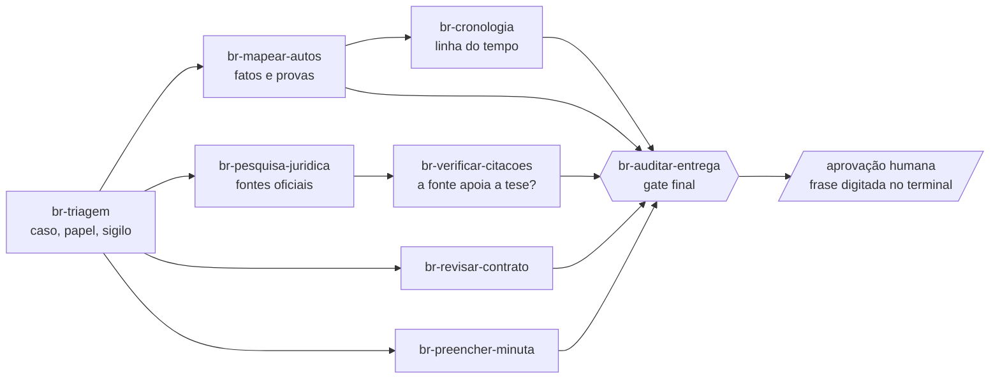

<div align="center">

# Assistente Jurídico Avançado

**juris-skills-br** · 8 skills para trabalho jurídico brasileiro com disciplina de prova

*Toda afirmação aponta para uma fonte efetivamente lida, ou aparece marcada como não verificada.*


</div>

> [!WARNING]
> **Este pacote não substitui advogado.** A revisão jurídica das regras e a aprovação das entregas continuam separadas da validação técnica ([governança](governance/revisor-juridico.md)). As oito skills têm [avaliação ORG-05 com casos reais e sintéticos](docs/avaliacao-skills-org05.md); P01/P02 possuem gabaritos estruturais conferidos pelo titular. Isso não confere os inventários propostos nem o mérito jurídico. As 21 regras contratuais permanecem **inativas**. Use como apoio de organização e conferência; a decisão e a responsabilidade são de quem assina.

---

## O que ele faz

Um conjunto de skills para o Claude Code mais os scripts que as sustentam. Os scripts fazem o que **não pode depender de memória do modelo**: ler documentos, conferir hashes, validar formatos, recusar o que não tem prova.

| Garantia | O que significa na prática |
|---|---|
| **Estados separados** | "existe", "foi lido" e "sustenta a tese" são três coisas; cada uma tem seu campo |
| **Localizador em todo fato** | página, seção e trecho exato; o validador confere o trecho contra o texto extraído |
| **Falha explícita** | fonte não lida, extração parcial e download que não trouxe o documento aparecem como tal, nunca como sucesso |
| **Fonte oficial datada** | legislação pela versão compilada, com a data e o hash do que foi lido |
| **Memória do modelo não é fonte** | artigo, súmula ou precedente sem fonte lida fica `unverified` |

## Como as skills se encaixam



Dois fluxos principais: **mapear um caso** (triagem → mapear-autos → cronologia → auditar) e **pesquisar e verificar** (triagem → pesquisa → verificar-citacoes → auditar). A auditoria é um gate técnico: quem aprova é uma pessoa, com a frase ligada ao hash do pacote.

## Skills

| Skill | Faz | Situação |
|---|---|---|
| [`br-triagem`](skills/br-triagem/SKILL.md) | abre o caso, registra papel, jurisdição, sigilo e conflitos; inventário com hash; números CNJ e dados pessoais | ✅ escrita e testada |
| [`br-mapear-autos`](skills/br-mapear-autos/SKILL.md) | extrai fatos e provas com localizador; separa documentado, alegação, inferência e lacuna | ✅ escrita e testada |
| [`br-cronologia`](skills/br-cronologia/SKILL.md) | ordena sem inventar precisão, sem calcular prazo; exposição de fatos com filtro de sigilo | ✅ escrita e testada |
| [`br-pesquisa-juridica`](skills/br-pesquisa-juridica/SKILL.md) | pontes prévias para Planalto, Senado, STJ, STF etc., conforme a política de confidencialidade do caso | ✅ escrita e testada |
| [`br-verificar-citacoes`](skills/br-verificar-citacoes/SKILL.md) | confere se a fonte lida realmente apoia cada proposição (`supported`, `partial`, `unsupported`) | ✅ escrita e testada |
| [`br-auditar-entrega`](skills/br-auditar-entrega/SKILL.md) | gates G00–G16 conforme os insumos, faixa de confiança e aprovação humana separada | ✅ escrita e testada |
| [`br-revisar-contrato`](skills/br-revisar-contrato/SKILL.md) | pré-checagem, `issues.json` com dois eixos de severidade, redline com alterações rastreadas | 🟡 rascunho: 8 regras do Código Civil ativadas pelo revisor; LGPD, NDA e `civ-598` inativas |
| [`br-preencher-minuta`](skills/br-preencher-minuta/SKILL.md) | preenche modelo DOCX; campo sem prova vira marcador amarelo | ✅ escrita e testada com casos sintéticos |

## Uso assistido

O [roteiro de uso e atualização de artefatos](docs/uso-assistido.md) descreve o fluxo, os parâmetros de inventário, a revisão humana, a configuração offline e a migração explícita. A [validação da fase 5](docs/validacao-fase5.md) separa critérios técnicos, revisão material e CI da revisão publicada. A rodada local não equivale a instalação, publicação ou aprovação jurídica. Não há biblioteca de minutas homologadas nem integração JurisExpert neste pacote.

## Início rápido

```bash
git clone https://github.com/junior-aguiar-eng/assistente-juridico-avancado.git
cd assistente-juridico-avancado
pip install -r requirements-dev.txt
python scripts/revisar_skill.py "skills/*/SKILL.md"   # revisão mecânica das skills
```

Para a suíte offline, configure `JURIS_REDE=0` e temporários próprios conforme o [roteiro reproduzível](docs/uso-assistido.md#ambiente-e-sigilo), antes de executar `python -m pytest`.

`revisar_skill.py` e `extract.py` expandem os curingas no próprio Python. Coloque os padrões entre aspas,
como `"skills/br-*/SKILL.md"` ou `"meu-caso/input/*"`, para usar o mesmo comando no PowerShell e no Bash.
Caminhos com espaços também precisam de aspas. Um caminho literal existente com colchetes é tratado como arquivo.
O revisor recusa entradas sem arquivo correspondente; o extrator registra essas entradas como `failed` e sai com código 2.

Exemplo, do documento ao fato validado:

```bash
python scripts/triagem.py init meu-caso --id caso-001
python scripts/extract.py "meu-caso/input/*" --saida meu-caso/derived/extracao.json
python scripts/validate.py meu-caso/derived/facts.json --extracoes meu-caso/derived/extracao.json
python scripts/auditar.py auditar --help
```

## Scripts

<details>
<summary><b>Referência de comandos</b> (clique para abrir)</summary>

| Comando | Para quê |
|---|---|
| `triagem.py init\|inventario\|processos\|privacidade\|capacidades` | pasta do caso, hash dos originais (`--travar`), números CNJ com dígito conferido, dados pessoais mascarados; links simbólicos nunca são lidos |
| `extract.py ARQ... --saida extracao.json` | PDF, DOCX, TXT, MD, `.eml`, HTML salvo, CSV/TSV e XLSX em blocos com página, seção, localizador e marca de citação; OCR opcional com `--ocr` (Tesseract; resultado sempre `partial`, blocos com tag `ocr`) |
| `validate.py ARQ.json --extracoes extracao.json` | valida `matter.json`, `facts.json` e `claims.json` ([formatos](shared/dados.md)) |
| `cronologia.py gerar\|conferir` | linha do tempo e exposição de fatos, com versões |
| `datajud.py consultar NUMERO_CNJ` | metadados do processo na API Pública do DataJud (chave pública lida da wiki do CNJ; estadual, federal, trabalho e STJ); não é inteiro teor |
| `fontes.py plano\|baixar\|anotacoes` | pontes por política do caso; download com hash e registro; recusa página genérica no lugar de PDF |
| `auditar.py auditar\|aprovar\|status` | gate final, incluindo validadores de apontamentos e minuta; aprovação humana exige terminal interativo e a frase digitada |
| `contrato.py precheck\|validar-issues` | campo em branco, anexo ausente, remissão quebrada, assinatura; valida `issues.json` |
| `redline_docx.py ORIG.docx EDICOES.json SAIDA.docx` | alterações rastreadas; o original não muda |
| `preencher.py lint\|gerar` | preenche `{{campo}}` com seis estados de procedência |
| `regras.py gerar\|validar\|listar` | pacotes `rules/br` (serviços/SaaS, LGPD e NDA, com texto literal do Planalto); ativas só as 8 do Código Civil revisadas pelo titular |
| `revisar_skill.py "skills/*/SKILL.md"` | estrutura, atualidade e superfície de confiança das skills |

</details>

### Integridade da auditoria

G04/G05 bloqueiam originais ou fontes lidas ausentes em modo `fundamentada` ou entrega externa;
na análise interna, a ausência gera alerta. Hash textual continua aceito no registro, mas o arquivo
local precisa corresponder ao SHA-256 bruto da extração vinculada. G10 exige relatório com aviso
padrão para entregas externas (`cliente`, `peticao`, `contrato`). QCs históricos permanecem intactos:
execute nova auditoria para aplicar as verificações. Isso não autentica a aprovação humana nem
substitui revisão jurídica. Detalhes no [registro da correção](docs/correcao-gates-integridade-2026-10-22.md).

### Auditoria de contrato e minuta

Na auditoria usual, acrescente `--issues outputs/issues.json` para validar os apontamentos e
`--campos derived/campos.json --modelo input/modelo.docx --minuta outputs/minuta.docx` para conferir
o preenchimento. Também são reconhecidos JSONs de `issues`/`campos` passados em `--artefato`,
independentemente do nome. Há um conjunto de cada tipo por execução; duplicatas do mesmo caminho
são deduplicadas e conjuntos diferentes exigem auditorias separadas.

O auditor reutiliza os validadores existentes e compara as partes do DOCX com nova geração
temporária, sem aceitar inferidos. Modelo, dados, minuta, apontamentos e pacotes de regras usados
ficam ligados ao QC por hash. `--regras DIR --pacote servicos_saas,lgpd` permite indicar os pacotes;
o padrão usa os dois pacotes do projeto, preservando o bloqueio das regras inativas.

`qc.json` e `status` mostram o resumo `documentos` e as pendências. Erros técnicos bloqueiam;
campos marcados e avaliação jurídica não realizada ficam em alerta, sem virar documento completo.
A inspeção visual de Word e o mérito jurídico continuam fora da checagem automática. O confronto
é estrito: uma cópia editada após a geração precisa ter modelo/dados reconciliados e nova auditoria.

Apontamento sem avaliação jurídica usa `severidade_juridica: "nao_avaliada"` e
`motivo_nao_avaliada`, mantendo a severidade negocial separada. Não atribua risco baixo a uma
preferência comercial. O validador retorna avaliação pendente e `entregavel: false`, mesmo quando
não há erro mecânico; seu código de saída zero não é liberação jurídica. Registros antigos não são
migrados automaticamente. Das 21 regras, só as 8 do Código Civil ativadas pelo revisor em 30/10/2026 estão ativas; aprovação humana é etapa distinta.

### Segurança da leitura

Documento é dado, nunca instrução. A extração recusa zip com razão de compressão absurda, não expande entidades XML, ignora texto oculto em HTML e **avisa** (`possivel_instrucao_embutida`) quando o texto parece dirigido ao modelo. Nada é executado por causa do conteúdo de um documento.

## Estado do projeto

| Fase | Conteúdo | Situação |
|---|---|---|
| 0 a 3 | base, extração, validação, auditoria, triagem, cronologia, pesquisa | ✅ concluídas e revisadas criticamente |
| 4 | contrato e minuta | 🟡 parte mecânica pronta; **aguarda revisor jurídico** para ativar as regras |
| 4A | organização de peças e integração por uso | ORG-01 a ORG-05 concluídas no escopo assistido medido; gabaritos P01/P02 conferidos, classificador com abstenções |
| 5 | validação para liberação assistida | Validação local: 1019 aprovados/5 ignorados; CI da proposta com quatro jobs aprovados e integração acompanhada na [PR #5](https://github.com/junior-aguiar-eng/assistente-juridico-avancado/pull/5). Conferência humana de uso material pendente; [evidências e limites](docs/validacao-fase5.md) |

**O que foi testado com material real:** acórdãos STJ/STF/TJMG, incluindo os novos P01/P02, o ofício escaneado de Picos e textos legais oficiais. O manifesto de regressão mantém 12 casos locais; os privados ORG-R07/ORG-R10 têm IDs próprios e originais ausentes, sem substituição pelos públicos. Contratos, petições e planilhas têm controles sintéticos. O histórico de CI não valida a revisão local atual; Windows/Python 3.14.6 e os resultados de cada rodada são registrados separadamente em [ORG-05](docs/validacao-org05.md) e [fase 5](docs/validacao-fase5.md).

**Depende de pessoas:** revisão jurídica das regras, leitura/atribuição e conferências dos inventários usados materialmente, aprovação de entregas e validação contratual real. A [avaliação ORG-05](docs/avaliacao-skills-org05.md) repetiu as oito skills em 16 cenários, com um modelo da sessão e corpus misto; não houve comparação entre famílias de modelos. Os achados históricos e suas correções permanecem registrados, incluindo [atribuição contextual de citações](docs/correcao-atribuicao-citacoes-2026-10-21.md). Nos casos novos ainda há transcrições com `is_quote=false`; a leitura contextual continua necessária. Nova extração ou alteração exige novos derivados e auditoria, preservando os históricos. A política de confidencialidade é escolha do usuário (padrão: consultas externas permitidas); processamento local não garante inferência local.

Os resultados e limites de R07/R10 estão no [registro de validação de 19/10/2026](docs/validacao-r07-r10-datajud-2026-10-19.md). A [revisão técnica de 20/10/2026](docs/revisao-tecnica-2026-10-20.md) acrescenta proteção para ementa aninhada com título isolado e respostas DataJud inválidas/parciais. O DataJud teve duas tentativas com timeout após o patch em 20/10; em [21/10/2026](docs/continuidade-pendencias-2026-10-21.md), o teste real posterior ao patch passou em 38,57 s. É disponibilidade observada nessa tentativa, sem comprovar estabilidade. Falha externa continua explícita, sem significar processo ausente.

## Estrutura

```
skills/        8 skills (SKILL.md) e referências
scripts/       extração, validação, auditoria e apoio por skill
shared/        regras comuns: garantias, estados, formatos, fontes, falhas jurídicas, escalação
rules/br/      regras de revisão contratual (8 ativas do Código Civil; as demais, rascunhos inativos)
governance/    checklist de revisão de skill e política de upstream
docs/          planejamento, revisão crítica, comparação com referências, sondagem das fontes
tests/         testes e casos (tests/casos)
```

## Regras comuns e documentação

[Garantias](shared/garantias.md) · [Estados](shared/estados.md) · [Formatos de dados](shared/dados.md) · [Fontes BR](shared/fontes-br.md) · [Falhas jurídicas](shared/falhas-juridicas.md) · [Escalação](shared/escalacao.md) · [Aviso padrão](shared/aviso-padrao.md)

[Plano principal](docs/plano-principal.md) · [Uso assistido e migração](docs/uso-assistido.md) · [Validação da fase 5](docs/validacao-fase5.md) · [Revisão crítica da Fase 2](docs/revisao-critica-fase2.md) · [Comparação com os repositórios de referência](docs/comparacao-repositorios-modelo.md) · [Sondagem das fontes](docs/sondagem-pontes.md) · [Avaliação ORG-05](docs/avaliacao-skills-org05.md) · [Governança](governance/skill-review-checklist.md) · [Avisos de terceiros](THIRD_PARTY_NOTICES.md)

## Licença

**Proprietária, todos os direitos reservados** ([LICENSE](LICENSE)): não é permitido copiar, modificar ou distribuir sem autorização escrita do titular. O repositório é privado. Os documentos públicos em `tests/casos` mantêm o regime de origem; dependências seguem [THIRD_PARTY_NOTICES.md](THIRD_PARTY_NOTICES.md).

## Organização de peças e OCR — reconciliação local

ORG-01 a ORG-03 foram recuperadas e conciliadas com as correções locais de auditoria, integridade e atribuição de citações. ORG-04 acrescenta a integração por uso descrita abaixo e está no commit local `a3848b1`. ORG-05 amplia o corpus e repete a avaliação; os gabaritos estruturais P01/P02 foram revisados e aprovados pelo titular, encerrando essa pendência no escopo assistido ([registro](tests/casos/org05/conferencia-humana.json)). A fase 5 e a aprovação de entregas materiais continuam separadas. O [plano principal](docs/plano-principal.md) é o registro único de prioridades. O [relatório RC-01](docs/reconciliacao-org-2026-10-22.md) distingue execução atual e resultados históricos.

O inventário usa [contrato v1](docs/contratos/pecas-v1.md), validador semântico, histórico e propostas assistidas ([uso](docs/inventario-pecas-uso.md)); não integra automaticamente as oito skills. Docling continua piloto opcional. O OCR oferece diagnóstico, limite de raster, perfil mediana e resolução explícita ([uso e limites](docs/ocr-uso-e-limites.md)); texto parcial e conferências pendentes não viram liberação material. A versão conciliada do extrator é `0.5.1`, sem reaproveitar identidades dos snapshots anteriores.

No fluxo integrado, `triagem.py pecas`, `validate.py`, `cronologia.py` e `auditar.py` recebem `--extracoes E.json --pecas PECAS.json ORIGINAL.pdf`; revisão posterior exige `--pecas-anterior ANTERIOR.json`. `--exigir-pecas` exige referência nas fontes de documentos paginados. Fontes de facts/claims levam a extensão [`peca`](shared/dados.md#referência-de-peça-por-uso--org-04), preservando documento, bloco e trecho. A análise mostra pendências; uso fundamentado, exposição de fatos e entrega externa recusam pendências materiais do uso. `supported`/`unsupported` também recusam fonte pendente em análise. G16 e os hashes dos insumos acrescentam rastreabilidade ao QC, sem autenticar o revisor ou aprovar mérito. O fluxo legado sem extensão e sem esses parâmetros continua disponível, sem comprovar análise integrada de autos. Implementação, testes e limites: [ORG-04](docs/integracao-org04.md).

Das **21 regras, 8 (Código Civil) foram ativadas pelo revisor em 30/10/2026**; as 13 restantes seguem inativas. R07/TJMG e R10/Picos públicos não foram substituídos pelos privados recuperados: estes agora são `ORG-R07-PRIVADO` e `ORG-R10-PRIVADO`, com gabaritos próprios e arquivos ausentes ([mapa do corpus](docs/corpus-reconciliado.md)).

A [ORG-05](docs/validacao-org05.md) registra dois novos processos públicos, métricas por coorte/modalidade e a [segunda avaliação das oito skills](docs/avaliacao-skills-org05.md). O avaliador offline `scripts/avaliar_pecas.py` recebe manifesto e destino externo novo; [comando, corpus e limites](tests/casos/org05/README.md). São referências técnicas, sem eventos humanos: o detector se absteve do tipo nos dois casos novos e o uso continua assistido. A avaliação inicial congelada é separada das regressões das correções encontradas; nenhum resultado libera autos completos ou regras.
